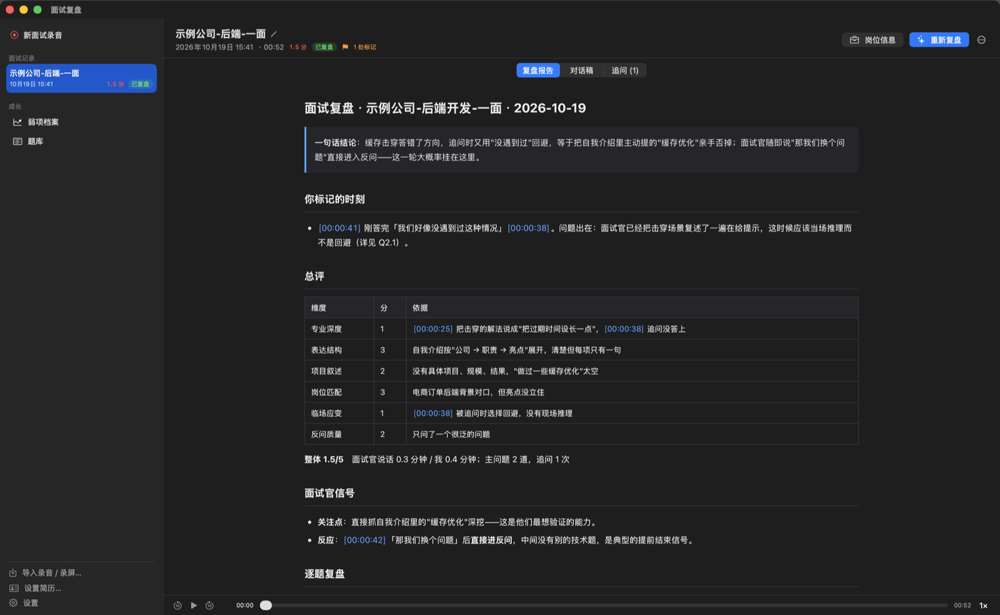
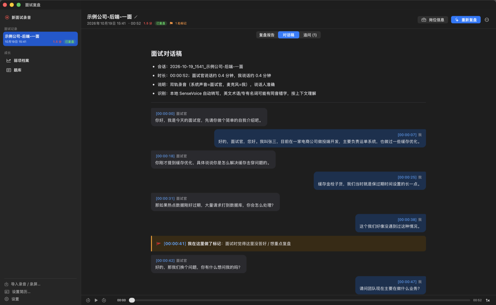
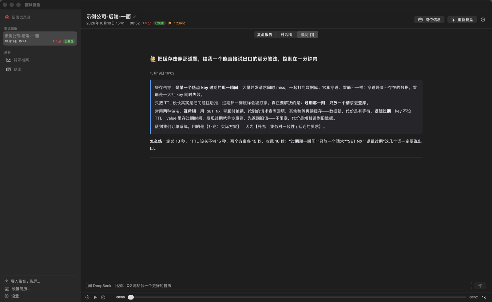

# Interview Review · 面试复盘

[中文](README.md) | English

A macOS app for job candidates: record your online interviews, transcribe them on your own Mac, and let an AI coach review every question — what the interviewer was really testing, where your answer fell short, a better answer built only from your real experience, and the follow-ups you should expect.

> The UI and the generated reports are in Chinese (the app was built for Mandarin interviews). The local speech model also handles mixed Chinese/English technical terms.



## Features

**Before the interview**
- 6-second **sound check** that verifies both tracks are being captured
- A readiness card: runtime, microphone / system-audio permissions, speech model, review model, résumé

**During the interview** (no need to switch back to the app)
- Global hotkeys: `⌃⌥⌘R` start/stop recording, `⌃⌥⌘M` flag "I didn't answer this well" — every flag gets addressed in the review
- **Two separate tracks**: what your Mac plays (the interviewer) and your microphone (you). Nothing joins the meeting, the other side can't tell, and speakers are never mixed up
- Works with Feishu/Lark Meetings, Tencent Meeting, Zoom and browser-based interviews; headphones optional (speaker echo is removed automatically)
- The microphone stream reconnects automatically (e.g. when Bluetooth earbuds switch to call mode) with a live alert; everything is backed up while recording and recovered after a crash or power loss

**After the interview**
- Automatic transcription → automatic review; paste the job description while it transcribes for a sharper review
- Every timestamp in the report and transcript is clickable and jumps the audio there; variable speed, current-line highlighting
- **Follow-up chat**: ask the AI about the review ("give me a better answer for Q2", "play the interviewer and keep drilling me")
- A cross-interview **weakness log** and **question bank**
- PDF export; import existing recordings / screen recordings (single-track files are diarized by voiceprint)
- **Feishu Minutes (飞书妙记) import** for higher-accuracy transcripts: export an upload-ready mix, transcribe it in Minutes, drop the exported transcript back in — speakers are matched using the two tracks

| Transcript (with 🚩 flags) | Follow-up chat |
|---|---|
|  |  |

## How it works

| Stage | Implementation |
|---|---|
| Recording | `recorder/Recorder.swift`: Core Audio global process tap (macOS 14.2+) for system audio, AVCaptureSession for the mic; both tracks aligned on the host clock, gaps padded with silence; ScreenCaptureKit as fallback |
| Transcription | `ir/asr.py`: [FunASR](https://github.com/modelscope/FunASR) fsmn-vad + SenseVoiceSmall on the local GPU (MPS) — about 5–6 minutes per hour of audio |
| Transcript | `ir/cli.py`: merges the tracks by time, removes speaker echo sentence by sentence, filters backchannels, inserts flags and recording gaps |
| Review | `skill/SKILL.md`: a Claude Code skill defining the per-question rubric and report structure; the app runs Claude Code headlessly to apply it |
| App | `app/Sources`: SwiftUI — menu bar, global hotkeys, notifications, reports rendered with WKWebView |

Recordings, transcripts and reports stay on your Mac in `~/Interviews/` (override with `INTERVIEW_HOME`).

## Install

### Option 1: DMG (recommended)

1. Download `InterviewReview-<version>-arm64.dmg` from [Releases](https://github.com/Wayzinx/interview-review/releases) (Apple silicon)
2. Drag the app into Applications
3. On first launch macOS says it can't verify the developer — the project isn't notarized (no paid Apple Developer account). Open **System Settings → Privacy & Security**, find the app near the bottom and click **Open Anyway**
4. On the first transcription the app downloads Python and the speech dependencies (~1 GB, a few minutes); after that it works offline

For reviews you also need either a logged-in [Claude Code](https://claude.com/claude-code) (subscription or API key) or a DeepSeek API key entered in Settings (Claude Code is still used as the agent).

### Option 2: from source

Requires macOS 15+, Xcode command line tools (`xcode-select --install`) and [uv](https://docs.astral.sh/uv/):

```bash
git clone https://github.com/Wayzinx/interview-review.git
cd interview-review
scripts/install.sh
open ~/Applications/面试复盘.app
```

Optional: `scripts/create-signing-identity.sh` creates a local code-signing certificate so macOS keeps the recording permissions across rebuilds.

## Review models

Settings → 复盘模型 (review model):
- **Claude Code**: uses your logged-in `claude`. If you manage several accounts with `~/.claude-accounts` + `cca`, an account picker appears
- **DeepSeek**: enter an API key (stored in the macOS Keychain), choose `deepseek-v4-pro` or `deepseek-flash`; uses DeepSeek's [Anthropic-compatible API](https://api-docs.deepseek.com/guides/anthropic_api) with a separate config dir `~/.claude-deepseek`

> Reviews run Claude Code headlessly with `--dangerously-skip-permissions`; the prompt confines it to the interview folder and `~/Interviews`. Read `skill/SKILL.md` if you want to know exactly what it does.

## Privacy & consent

- Recording and transcription happen locally; only the **transcript text** is sent to the model you choose when generating a review or follow-up
- **Get the other party's consent before recording** and follow local law and company policy — some companies forbid recording interviews
- Don't upload job-interview recordings to your current employer's systems (e.g. a company Feishu tenant)

## Development

```bash
uv sync && uv run pytest -q            # transcript logic tests (no speech model needed)
recorder/build.sh && app/build.sh      # build; app/build.sh refuses to reinstall while a recording is running
scripts/package-dmg.sh                 # build the DMG (bundles the transcriber, the skill and uv)
```

`app/Sources/Debug.swift` contains environment-variable-gated hooks (automatic screenshots, triggering transcription / review / sound check / runtime setup). The README screenshots were generated with them from a synthetic demo interview.

## Known limitations

- The local speech model is small; technical terms and homophones get garbled (the AI corrects from context, or use the Feishu Minutes import)
- Feishu Minutes export formats are undocumented; the parser is deliberately lenient — please open an issue with a sample if one fails
- Single-track imports assume two speakers
- Coding rounds only capture the spoken part
- The system-audio permission check uses a private macOS TCC API (falls back to "authorized" if unavailable)
- The DMG is Apple-silicon only and not notarized

## Credits

[FunASR / SenseVoice](https://github.com/modelscope/FunASR), [marked](https://github.com/markedjs/marked) (MIT, vendored), [uv](https://github.com/astral-sh/uv) (MIT / Apache-2.0, bundled in the DMG)

## License

[MIT](LICENSE)
