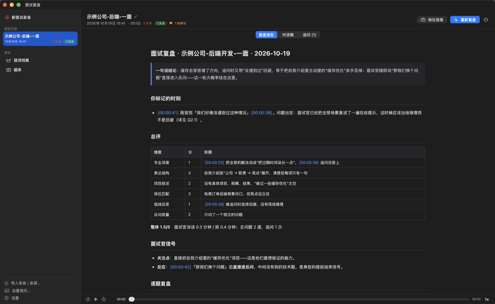
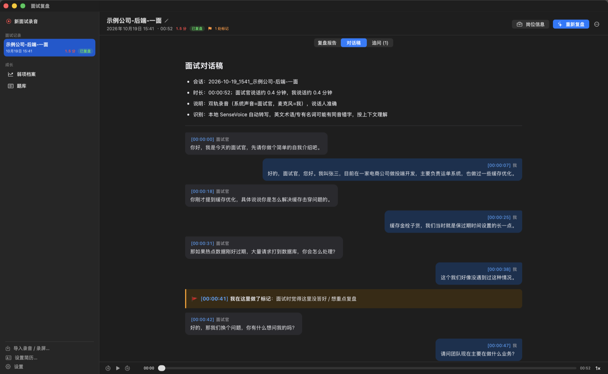
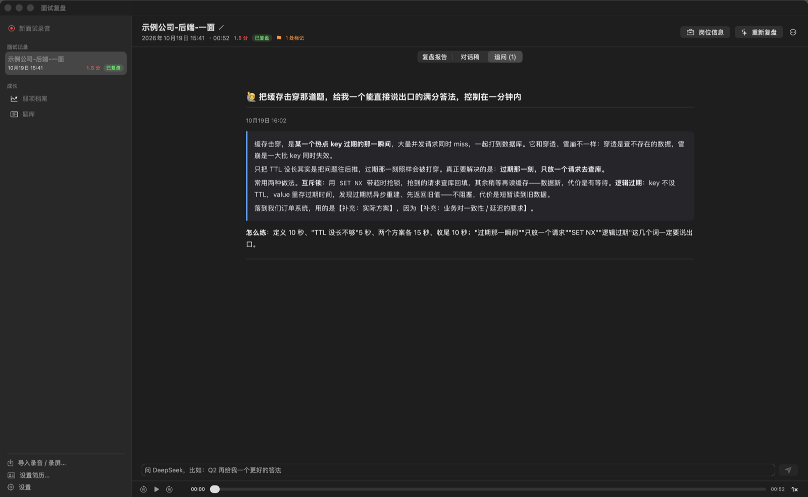
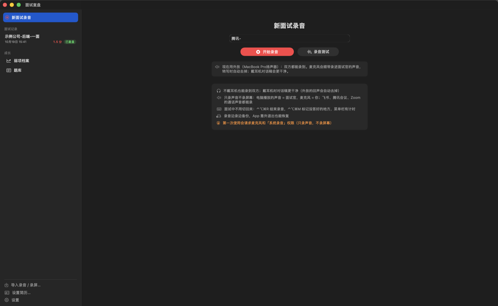
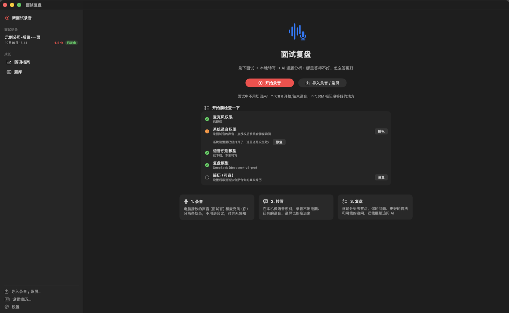

# 面试复盘 · Interview Review

中文 | [English](README.en.md)

录下线上面试 → 在本机转写成对话稿 → 让 AI 逐题复盘：面试官在考察什么、你哪里没答好、怎么答更好、还可能被怎么追问。

*A macOS app that records your online interviews (interviewer + you on separate tracks), transcribes them locally, and has an AI coach review every question — what was being tested, where your answer fell short, and a better answer built only from your real experience.*



## 它能做什么

**面试前**
- 「录音测试」：6 秒确认两条轨都能录到
- 「开始前检查一下」：麦克风 / 系统录音权限、语音模型、复盘模型、简历一目了然

**面试中**（不用切回 App）
- `⌃⌥⌘R` 开始 / 结束录音，`⌃⌥⌘M` 标记"这里没答好"，复盘时会专门回应每个标记
- 电脑播放的声音（面试官）和麦克风（你）**分两条轨录**：不用进会议、对方无感知，说话人不会分错
- 飞书会议、腾讯会议、Zoom、浏览器里的面试都能录；戴不戴耳机都行（外放的回声会自动去掉）
- 麦克风断流（比如蓝牙耳机切到通话模式）自动重连并报警；边录边备份，App 崩溃或断电后能恢复

**面试后**
- 自动转写 → 自动生成复盘；转写时顺手填岗位 JD，复盘更有针对性
- 报告和对话稿里的时间戳可以点，直接跳到那一句回听；倍速播放、当前句高亮
- 「追问」：对报告有疑问直接问 AI（"Q2 再给我一个更好的答法""扮演面试官继续追问我"）
- 跨场次的**弱项档案**和**题库**，看出哪类题反复答不好
- 导出 PDF、导入已有录音 / 录屏（单轨也行，靠声纹区分说话人）
- **用飞书妙记转写**（更准）：一键导出上传用的混音，在妙记里转写后把文字记录拖回来，说话人按两条音轨自动对上

| 对话稿（带 🚩 标记） | 追问 |
|---|---|
|  |  |

| 录音 | 首页 |
|---|---|
|  |  |

## 工作原理

| 环节 | 实现 |
|---|---|
| 录音 | `recorder/Recorder.swift`：Core Audio 全局音频捕获（macOS 14.2+）录电脑播放的声音，AVCaptureSession 录麦克风，两条轨按主机时钟对齐，断流补静音；ScreenCaptureKit 兜底 |
| 转写 | `ir/asr.py`：[FunASR](https://github.com/modelscope/FunASR) 的 fsmn-vad 切句 + SenseVoiceSmall 识别，本机 GPU（MPS）运行，1 小时录音约 5～6 分钟 |
| 对话稿 | `ir/cli.py`：两轨按时间合并、逐句去回声、过滤附和声；插入 🚩 标记和录音缺口 |
| 复盘 | `skill/SKILL.md`：一份 Claude Code skill，规定逐题分析的标准和报告结构；App 以无界面方式调用 Claude Code 执行它 |
| App | `app/Sources`：SwiftUI，菜单栏、全局快捷键、通知、WKWebView 渲染报告 |

录音、对话稿和报告都存在本机 `~/Interviews/`（可用环境变量 `INTERVIEW_HOME` 改）。

## 安装

### 方式一：下载 DMG（推荐）

1. 到 [Releases](https://github.com/Wayzinx/interview-review/releases) 下载 `InterviewReview-<版本>-arm64.dmg`（Apple 芯片）
2. 把「面试复盘」拖进「应用程序」
3. 第一次打开会提示"无法验证开发者"：项目没有付费的 Apple 开发者账号做公证。到 **系统设置 → 隐私与安全性**，在下方找到面试复盘，点 **仍要打开**
4. 首次转写时 App 会自动下载 Python 和语音识别依赖（约 1GB，几分钟），之后离线可用

生成复盘还需要任意一种模型：已登录的 [Claude Code](https://claude.com/claude-code)（订阅或 API key 都行），或在设置里填 DeepSeek API key（仍借助 Claude Code 当 agent）。

### 方式二：从源码安装

需要 macOS 15+、Xcode 命令行工具（`xcode-select --install`）和 [uv](https://docs.astral.sh/uv/)：

```bash
git clone https://github.com/Wayzinx/interview-review.git
cd interview-review
scripts/install.sh          # Python 依赖、录音器、App、interview 命令、Claude Code skill
open ~/Applications/面试复盘.app
```

可选：`scripts/create-signing-identity.sh` 在钥匙串里生成一张本机签名证书。没有它时 App 是临时签名，**每次重新编译都要重新授权录音权限**；有了它授权会一直有效。

第一次录音会请求**麦克风**和**系统录音**权限（只录声音，不录屏幕）。首次转写会从 ModelScope 下载约 1GB 的语音模型。

## 使用

- **App**：新面试录音 → 填"公司-岗位-轮次" → 开始录音 → 面试结束点"结束录音并转写"，其余自动完成
- **命令行**：`interview rec 某公司-后端-一面`、`interview import 录屏.mp4`、`interview ls`
- **Claude Code**：在 Claude Code 里输入 `/interview-review`，复盘最近一场
- **飞书妙记**：单场面试右上角「⋯」→「用飞书妙记转写（更准）」，按三步引导走。**请用个人飞书账号**，用公司账号的话面试录音会存进公司的飞书空间

### 复盘模型

设置 → 复盘模型：
- **Claude Code**：用本机已登录的 `claude`。如果你用 `~/.claude-accounts` + `cca` 管理多个账号，这里会多出账号选择
- **DeepSeek**：填 API key（存在 macOS 钥匙串），模型可选 `deepseek-v4-pro` / `deepseek-flash`；走 DeepSeek 的 [Anthropic 兼容接口](https://api-docs.deepseek.com/guides/anthropic_api)，配置目录独立在 `~/.claude-deepseek`

> 复盘时 Claude Code 以无界面、跳过权限确认（`--dangerously-skip-permissions`）的方式运行，提示词限定它只读写当前面试目录和 `~/Interviews`。介意的话可以先读一遍 `skill/SKILL.md`。

## 隐私与合规

- 录音和转写都在本机完成；只有生成复盘 / 追问时，**对话稿文字**会发给你选的模型
- **录音前请征得对方同意**，并遵守当地法律和公司规定；有些公司的面试协议明确禁止录音
- 求职面试的录音和对话稿不要上传到现任公司的系统（比如公司的飞书、钉钉）

## 开发

```bash
uv sync                               # 含测试依赖
uv run pytest -q                      # 对话稿逻辑的单元测试（不需要语音模型）
recorder/build.sh && app/build.sh     # 编译；正在录音时 app/build.sh 会拒绝覆盖安装
interview-py render <面试目录>         # 不重跑识别，只重新生成对话稿
scripts/package-dmg.sh                # 打包 DMG：内置转写程序、复盘规则和 uv，首次启动自动准备环境
```

`app/Sources/Debug.swift` 里有一组只在设置了环境变量时才生效的调试开关（自动截图、触发转写 / 复盘 / 录音测试），README 的截图就是这么生成的，用的是合成的示例面试。

## 已知限制 / 计划

- 本地识别模型较小，英文术语和同音字会有错；复盘时 AI 会按上下文纠正，也可以改用飞书妙记转写
- 飞书妙记导出格式没有公开文档，解析器按常见格式写得比较宽松；遇到解析不了的导出文件欢迎提 issue
- DMG 只有 Apple 芯片版本，且没有公证（见上面的安装说明）
- 单轨导入按两个人处理，多位面试官同场可能分错
- 写代码环节只有口头部分，看不到代码
- "系统录音"权限状态的查询用到了 macOS 的私有 TCC 接口（查不到时按已授权处理）

## 致谢

[FunASR / SenseVoice](https://github.com/modelscope/FunASR)、[marked](https://github.com/markedjs/marked)（MIT，随仓库附带于 `app/Resources/marked.min.js`）、[uv](https://github.com/astral-sh/uv)（MIT / Apache-2.0，DMG 里内置用于准备运行环境）

## License

[MIT](LICENSE)
